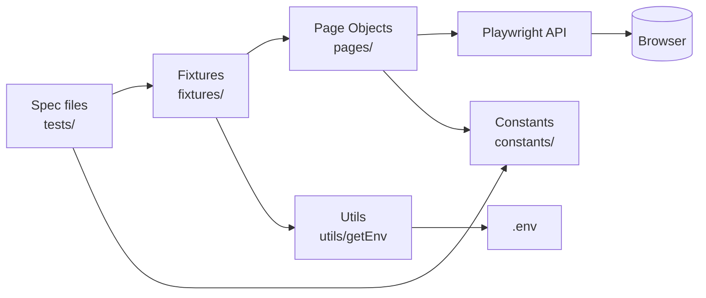
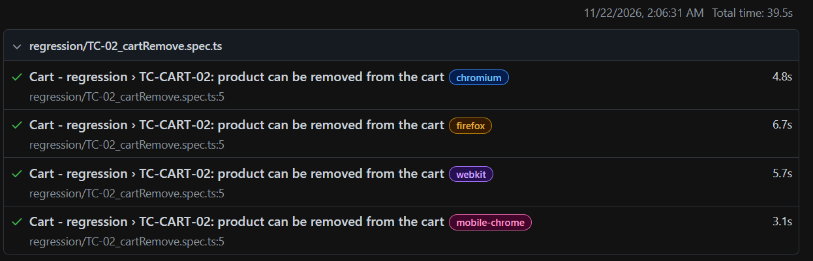
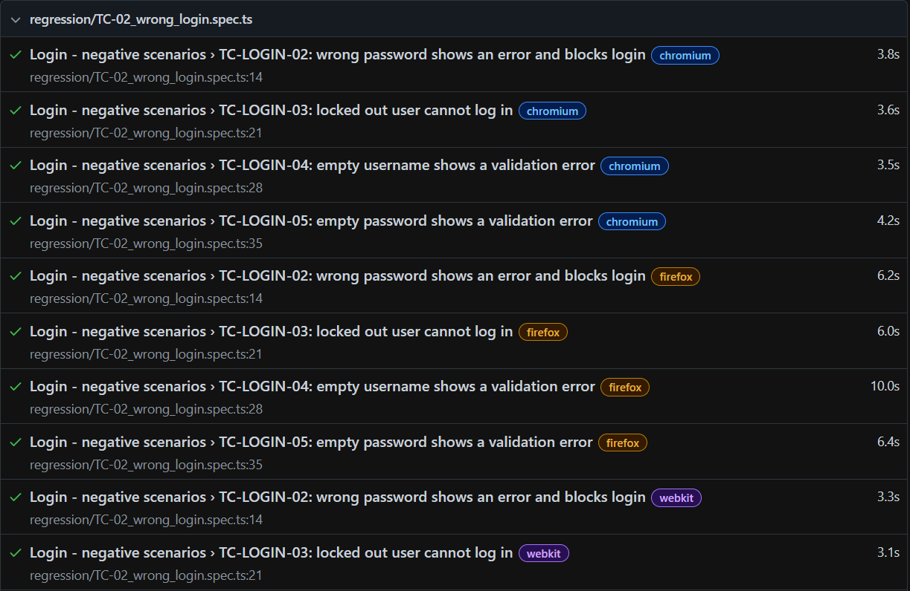
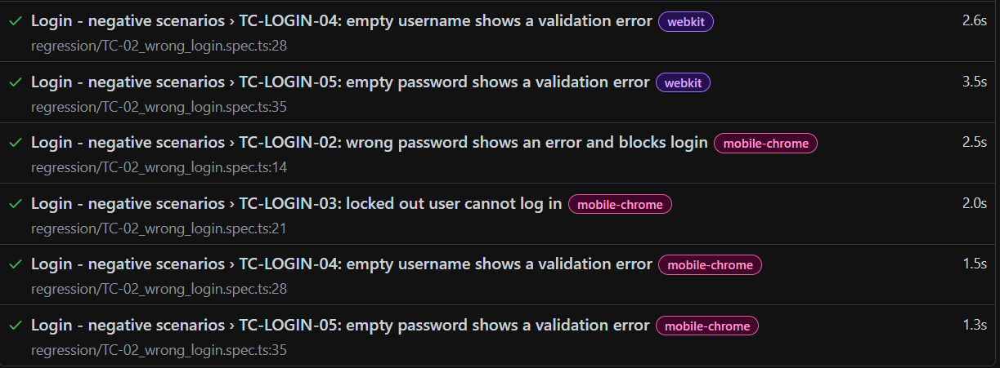
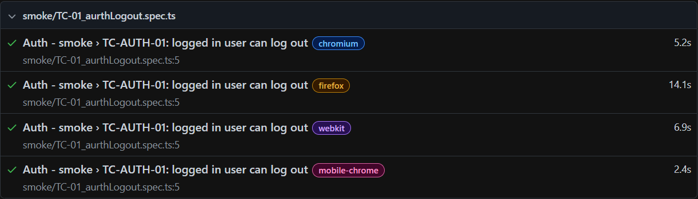
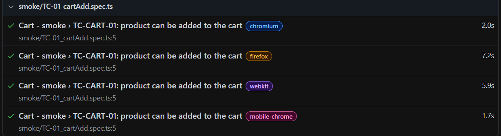
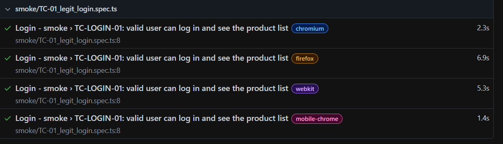
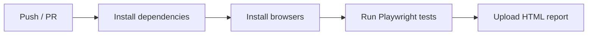

<div align="center">

# 🎭 Web Automation Framework

**Scalable end-to-end test automation with Playwright, TypeScript and the Page Object Model**


[Overview](#-overview) •
[Test Matrix](#-test-case-matrix) •
[Architecture](#-architecture) •
[Quick Start](#-quick-start) •
[Commands](#-running-tests) •
[CI](#-continuous-integration)

</div>

---

## Table of Contents

- [Overview](#-overview)
- [Tech Stack](#-tech-stack)
- [Test Case Matrix](#-test-case-matrix)
- [Architecture](#-architecture)
- [Project Structure](#-project-structure)
- [Design Decisions](#-design-decisions)
- [Quick Start](#-quick-start)
- [Running Tests](#-running-tests)
- [Test Report](#-test-report)
- [Continuous Integration](#-continuous-integration)
- [Adding a New Test](#-adding-a-new-test)
- [Roadmap](#-roadmap)
- [Author](#-author)

---

## Overview

This project is a reusable automation scaffold. It is demonstrated on [SauceDemo](https://www.saucedemo.com), a public practice e-commerce site, and covers authentication, cart and logout flows.

| Metric | Value |
|---|---|
| Total test cases | **8** |
|  Smoke | 3 |
|  Regression | 5 |
| Page Objects | 3 |
| Browsers configured | Chromium, Firefox, WebKit, Mobile Chrome |

---

## Tech Stack

| Tool | Purpose |
|---|---|
| 🎭 **Playwright** | Browser automation and web-first assertions |
| 🔷 **TypeScript** | Type-safe test code |
| 🟢 **Node.js** | Runtime |
| 🔐 **dotenv** | Environment configuration |
| ⚙️ **GitHub Actions** | Continuous Integration |

---

## Test Case Matrix

| ID | Title | Area | Suite | Spec file | Status |
|---|---|---|---|---|---|
| TC-LOGIN-01 | Valid user can log in and see the product list |  Login |  Smoke | `tests/smoke/TC-01-legit-login.spec.ts` | ✅ Automated |
| TC-LOGIN-02 | Wrong password shows an error and blocks login |  Login |  Regression | `tests/regression/login-negative.spec.ts` | ✅ Automated |
| TC-LOGIN-03 | Locked out user cannot log in |  Login |  Regression | `tests/regression/login-negative.spec.ts` | ✅ Automated |
| TC-LOGIN-04 | Empty username shows a validation error |  Login |  Regression | `tests/regression/login-negative.spec.ts` | ✅ Automated |
| TC-LOGIN-05 | Empty password shows a validation error |  Login |  Regression | `tests/regression/login-negative.spec.ts` | ✅ Automated |
| TC-CART-01 | Product can be added to the cart | 🛒 Cart |  Smoke | `tests/smoke/cart.spec.ts` | ✅ Automated |
| TC-CART-02 | Product can be removed from the cart | 🛒 Cart |  Regression | `tests/regression/cart-remove.spec.ts` | ✅ Automated |
| TC-AUTH-01 | Logged in user can log out |  Auth |  Smoke | `tests/smoke/logout.spec.ts` | ✅ Automated |

<details>
<summary><b> Smoke vs Regression: what's the difference?</b></summary>

<br>

| |  Smoke |  Regression |
|---|---|---|
| **Goal** | Is the site alive and are critical paths working? | Do edge cases and negative scenarios still behave? |
| **Speed** | Fast | Slower |
| **When to run** | Every commit | Nightly or before release |
| **Command** | `npm run test:smoke` | `npm run test:regression` |

</details>

<details>
<summary><b> Test case format used in this project</b></summary>

<br>

Every test case is designed before it is coded:

- **ID:** unique identifier, for example `TC-LOGIN-01`
- **Title:** one clear purpose
- **Preconditions:** the state required before the test starts
- **Steps:** what the user does
- **Expected result:** what must be observed
- **Suite:** smoke or regression

</details>

---

## Architecture



**Layers, from top to bottom:**

1. **Specs** describe *what* is tested and contain assertions only.
2. **Fixtures** prepare preconditions, such as a user who is already logged in.
3. **Page Objects** describe *how* to interact with each page. All locators live here.
4. **Constants and utils** hold routes, messages, timeouts and environment access.

---

## Project Structure

```
web-automation-framework/
├── 📂 tests/
│   ├── 📂 smoke/              # Critical-path tests
│   └── 📂 regression/         # Negative and edge-case tests
├── 📂 pages/                  # Page Objects (all locators live here)
├── 📂 fixtures/               # Custom fixtures (pre-logged-in page)
├── 📂 constants/              # Routes, messages, timeouts, test data
├── 📂 utils/                  # Helpers (getEnv)
├── 📂 docs/images/            # README images
├── 📂 .github/workflows/      # CI pipeline
├── 📄 playwright.config.ts
├── 📄 tsconfig.json
├── 📄 .env.example
└── 📄 package.json
```

---

## Design Decisions!

| Practice | Why it matters |
|---|---|
| **Page Object Model** | No locators in specs. When the UI changes, only one Page Object changes. |
| **Fixtures** | The logged-in precondition is written once, not copied into every test. |
| **Independent tests** | Each test starts from a fresh page and can run in any order. |
| **Web-first assertions** | No fixed sleeps. Playwright auto-waits and retries, which reduces flaky tests. |
| **Resilient locators** | `data-test` attributes and `getByRole` instead of brittle XPath. |
| **No hardcoded config** | URLs and credentials come from `.env`. Constants replace magic strings. |
| **Fail-fast env access** | `getEnv()` throws a clear error if a variable is missing. |
| **Artifacts on failure** | Screenshots, videos and traces are kept only when a test fails. |

---

## Quick Start

**Prerequisites:** [Node.js 20+](https://nodejs.org) and [Git](https://git-scm.com).

```powershell
git clone https://github.com/YOUR_USERNAME/web-automation-framework.git
cd web-automation-framework
npm install
npx playwright install
copy .env.example .env
```

<details>
<summary><b>🔧 Environment variables</b></summary>

<br>

| Variable | Description |
|---|---|
| `BASE_URL` | Website under test |
| `STANDARD_USER` | Valid username |
| `LOCKED_USER` | Locked-out username |
| `USER_PASSWORD` | Password shared by the demo users |

The demo credentials are public on SauceDemo. For a real site, never commit credentials. Keep them in `.env` locally and in GitHub Secrets for CI.

</details>

---

## Running Tests

| Command | What it does |
|---|---|
| `npm test` | Run all tests on all configured browsers |
| `npm run test:smoke` | Run smoke tests only |
| `npm run test:regression` | Run regression tests only |
| `npm run test:headed` | Run with a visible browser |
| `npx playwright test --project=chromium` | Run on Chromium only |
| `npx playwright test -g "TC-LOGIN-02"` | Run one test by name |
| `npx playwright test --ui` | Open Playwright UI mode |
| `npm run typecheck` | TypeScript type check |

---

## Test Report

```powershell
npm run report
```













On failure, a screenshot, video and trace are saved under `test-results/`.

<details>
<summary><b>🔍 Debugging a failed test with Trace Viewer</b></summary>

<br>

```powershell
npx playwright show-trace test-results\<test-folder>\trace.zip
```

The trace shows every action, a DOM snapshot at each step, network calls and console logs.

</details>

---

## Continuous Integration

Every push and pull request triggers a GitHub Actions workflow:



The HTML report is attached to each run as the `playwright-report` artifact.

---

## Adding a New Test

1. **Design first:** write the test case (ID, title, preconditions, steps, expected result).
2. **Locators:** find them with `npx playwright codegen <url>`.
3. **Page Object:** add or extend a class in `pages/`.
4. **Constants:** put routes and messages in `constants/`.
5. **Spec:** create `tests/smoke/` or `tests/regression/` with a `*.spec.ts` name.
6. **Matrix:** add a row to the Test Case Matrix above.

> ⚠️ Playwright only discovers files ending in `.spec.ts` or `.test.ts`.


---

## 👨‍💻 Author

**Sadman Islam Jim**
CSE student, American International University-Bangladesh (AIUB)

[](https://github.com/SaadmaanJim)
[](https://www.linkedin.com/in/sadman-jim-bb004134a/)

<div align="center">


</div>
